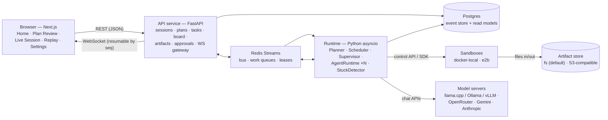

# Agent Platform

**A team of AI agents does real computer work together — and you can watch, steer,
and trust every step.**

You give one request: a **Planner** turns it into a dependency graph of tasks you
review and edit. Then up to six **Agents** work in parallel, each on its own
throwaway Linux desktop with a browser, LibreOffice and a terminal, driving it
through a vision-based observe → think → act loop. They collaborate **while** they
work — sharing findings on a live board, asking each other questions, claiming scope,
and handing files to each other — under the eye of a **Supervisor** that reviews
results, unblocks, and re-plans. You watch every screen live, take over whenever you
like, and approve anything sensitive. Everything is event-sourced, so any session can
be replayed as one unified timeline.

> The project has no final product name yet. In code it is the neutral
> `agentplatform` (Python package, Docker image) and the `APP_` env prefix.

## Why it is different

Most "agent team" demos share notes only after a task ends, broadcast follow-ups to
everyone, lose the plan's ordering after approval, and have no way to tell whether an
agent is hopelessly clicking the same pixel. This platform fixes each of those
weaknesses as a hard requirement (SPEC §1):

- **A live shared Board.** Every agent step receives an inbox digest of new, relevant
  entries — facts, claims, decisions — so agents react to each other's findings
  *during* the work, not afterwards.
- **Real dialogue.** `question`/`answer` pairs, direct messages and claims (scope
  reservations with conflict detection) are first-class: one shared board, but
  addressed visibility for direct items.
- **Hand-offs that actually move files.** An artifact store with sha256 versioning
  moves files between sandboxes; a downstream agent starts with its upstream's files
  already in `Shared/`.
- **The plan survives approval.** Tasks form a real DAG with typed inputs/outputs,
  persisted and versioned; follow-ups extend it instead of restarting it.
- **A Supervisor that does something.** Stuck detection, result review against
  acceptance criteria, rework requests, claim-conflict decisions, re-planning — every
  action logged with its "why".
- **You are in the loop.** Addressed task assignment (never broadcast), steering
  messages into the next step, one-click takeover of a desktop, approval gates for
  sensitive actions, and a kill switch that stops all agents within 5 seconds.
- **Not locked to one vendor.** Models (llama.cpp, Ollama, vLLM, OpenRouter, Gemini,
  Anthropic) and sandboxes (free local Docker desktops, E2B cloud) are pluggable by
  config, and every provider is held to the same contract tests.

## Status

This is a work-in-progress build; components are merged wave by wave.

**Merged:** contracts + generated TypeScript types; Postgres event store,
repositories and Redis bus/leases; model adapters (OpenAI-compatible + Anthropic) with
retries, accounting, concurrency limits and a text-action fallback parser; the action
layer (coordinate modes, key normalization, observations); the sandbox image,
`docker_local` and `e2b` providers under one contract suite; the agent step loop
(desktop + control tools, history management, stuck detection); the Planner and the
Scheduler/AgentPool (leases, affinity, addressed assignment); board + inbox digest +
coordination tools; artifact store (fs/S3) + publish/fetch/pre-fetch; the frontend
app (Home, Plan Review with DAG editor, Live Session, Replay) running against mock
fixtures; the eval fixtures/checks/runner.

**Not merged yet / in progress:** the REST + WebSocket API service, the runtime
process wiring ("first light"), the Supervisor (currently a stub — reviews auto-accept
until then), the human-in-the-loop backend (approval gates, forbidden typing, kill
switch enforcement), hardening + security review, and the first eval report. Until
those land the services are stubs and nothing runs end-to-end yet — the pieces above
are each merged with their own tests.

## Architecture

The component view below mirrors the diagram in `docs/architecture.md`, which also
carries the component map, the decisions list and the ADRs.



Two ideas explain most of the design:

- **Agents are not in the sandboxes.** Each agent is an asyncio task in the runtime;
  the sandbox only receives low-level actions (click, type, key, command, files).
  Model API keys and agent code never enter a sandbox.
- **Everything is an event.** Every state change is appended to Postgres in one
  transaction that also updates the read models; the WebSocket gateway streams events
  and resumable clients replay by sequence number. Crashes and reconnects lose
  nothing.

## Documentation

| Page | Contents |
|---|---|
| [`docs/architecture.md`](docs/architecture.md) | Components, flow of a user action, decision records, ADRs |
| [`docs/agent-loop.md`](docs/agent-loop.md) | The observe → think → act loop, context layout, control and leases |
| [`docs/coordination-protocol.md`](docs/coordination-protocol.md) | Board semantics, inbox digest algorithm, scheduling, budgets |
| [`docs/models.md`](docs/models.md) | Model client stack, provider behaviour, recipes per server |
| [`docs/sandboxes.md`](docs/sandboxes.md) | `docker_local` provider, security notes, known issues |
| [`docs/sandboxes-e2b.md`](docs/sandboxes-e2b.md) | E2B cloud desktops, limits, error mapping |
| [`docs/configuration.md`](docs/configuration.md) | Every env var and YAML key with defaults |
| [`docs/faq.md`](docs/faq.md) | Frequent questions and troubleshooting |
| [`docs/demo-script.md`](docs/demo-script.md) | Draft 2-minute demo walkthrough |
| [`docs/adr/`](docs/adr/) | Architecture decision records (0001–0003) |
| [`SPEC.md`](SPEC.md) | The full specification — source of truth |
| [`evals/README.md`](evals/README.md) | The evaluation harness and how to run it |

## Quickstart

> **TODO — the quickstart cannot be verified yet.** The REST/WebSocket API service
> and the runtime process wiring are stubs on `main` (tasks T09/T13). When they
> merge, the free local path will be: start Postgres + Redis, configure `.env` +
> `config/models.yaml`, build the sandbox image, and run `make dev` for API +
> runtime + web. Until then you can already develop and test components (the
> frontend runs standalone in mock mode with `NEXT_PUBLIC_MOCK=1`).

Prerequisites (real today): Docker + Docker Compose, [`uv`](https://docs.astral.sh/uv/)
for the backend, `pnpm` (or Corepack) for the frontend, and a model endpoint for the
agent role — a local vision model server (llama.cpp / Ollama / vLLM) or a cloud
provider key.

```sh
make install          # backend deps (uv) and frontend deps (pnpm)
make db-up            # Postgres + Redis (compose); creates your database
make db-migrate       # apply migrations
make sandbox-image    # build the local desktop sandbox image (once)
make contracts-check  # confirm generated contracts are fresh
```

**TODO: run steps, first-session walkthrough, and troubleshooting pointers once
`make dev` wires the three processes (T13).** See `docs/configuration.md` for every
setting and `docs/models.md` for pointing a profile at your model server.

## Demo

> **TODO (GIF)** — a short GIF/screen-capture of three agents collaborating, recorded
> from the Replay page (task lanes, board messages as arrows, the artifact hand-off).
> Nothing to record until the runtime is wired; the planned walkthrough is drafted in
> [`docs/demo-script.md`](docs/demo-script.md).

## Evaluation

The harness compares three modes on the same tasks — `solo`,
`parallel_isolated` (side by side, no communication) and `coordinated` — against a
frozen fixture website, with deterministic checks (artifact shape, JSON keys, and
that injected instructions were never followed), reporting duplicated work, tokens,
cost, stuck events and more (SPEC §20, `evals/README.md`).

> **TODO (eval results table)** — the runner and fixtures are merged, but no platform
> evaluation has run yet (it needs the API/runtime wiring). The table with zoomed-in
> numbers goes here from `evals/reports/*.md` once a real run is committed.

```sh
uv run --project backend python -m evals.runner \
  --tasks evals/tasks --modes solo,parallel_isolated,coordinated \
  --repeats 3 --profile local-free
```

## Safety

In short — the human is in the loop and the blast radius is contained
(SPEC §15, `docs/sandboxes.md` has the full notes):

- **Approval gates.** Agents must call `request_approval` before submitting third-party
  forms, purchases, sending messages, deleting files outside their `Shared`/`tmp`, or
  creating accounts; you see a screenshot and decide (approval cards expire in
  15 minutes). Passwords, card numbers and government IDs are forbidden outright and
  typing them is blocked with an `ERROR` the model must correct.
- **Nothing secret enters a sandbox.** API keys live in the backend `.env`; e2b's key
  is never passed into a VM; each sandbox gets only a per-container control token.
- **Untrusted content stays data.** Screenshots, web pages, other agents' posts are
  data — never rendered as HTML, never executed, never used to build host commands.
  Only the task, decisions, and your steering are instructions.
- **Isolation trade-off, stated plainly.** A local container shares the host kernel;
  it is hard-configured (no mounts, no privileged, dropped capabilities, loopback
  ports) but weaker than the E2B cloud VM option. Takeover gives the *user* the
  interactive stream — the agent's loop pauses.
- **Watchable at every level.** View-only streams by default, one-click takeover with
  a banner, a kill switch that stops everything within 5 s, and a full event log for
  the forensic replay.

## Roadmap

Milestones from SPEC §23, with current status (each wave merges before the next):

| Milestone | Status |
|---|---|
| **M0** Foundation: contracts, DB schema, interfaces, fakes, CI green | ✅ merged |
| **M1** One agent end-to-end: sandbox image + `docker_local` + agent loop live | 🧩 components merged; needs API + runtime wiring |
| **M2** Many agents + DAG: planner, approval, scheduler with leases | 🧩 components merged; needs wiring |
| **M3** Collaboration: board, digest, coordination tools, artifact hand-offs | 🧩 components merged; needs wiring |
| **M4** Supervisor: triggers, review, rework, re-planning, stuck handling | ⬜ next up (runtime + supervisor tasks) |
| **M5** Human-in-the-loop + UI: steering, takeover, approvals, kill switch | 🧩 UI pages merged; backend + API pending |
| **M6** Proof: eval harness + report comparing modes; docs + README | 🧩 harness ready; report, docs and README in progress |

## License

> **TODO** — no license has been chosen yet; there is no `LICENSE` file in the
> repository. Decide before making the repo public or accepting outside
> contributions.
